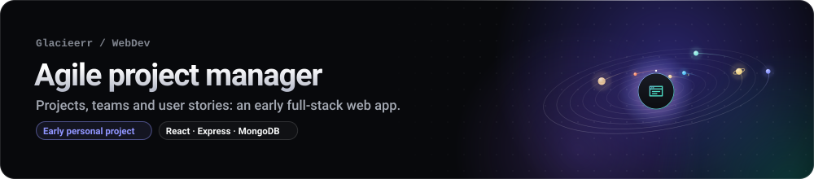

<picture>
  <source media="(prefers-color-scheme: light)" srcset=".github/readme/header-light.svg">
  
</picture>

**An early full-stack web app for agile project management: sign up and log in, create projects and teams, write user stories and assign them to team members.**

Early personal project, no longer maintained.

## What's inside

| Part | Files |
|---|---|
| Front end (React) | `src/`: `Login.js`, `Signup.js`, `Home.js`, `TeamRoster.js`, `UserStory.js`, `components/` |
| REST API (Node.js, Express) | `server/server.js`: sign-up, login with JWT, projects, teams and user stories |
| Data models (Mongoose) | `server/models/` |

## How to run

This upload has no `package.json`, so it does not install as it stands; it is here to read. The server listens on port 5001 and needs a MongoDB connection string and a JWT secret, which are placeholders in `server/server.js`.

## Tests

Only the starter test from the React template (`src/App.test.js`).

## Tech stack

React (react-router, axios); Node.js with Express, MongoDB through Mongoose, and JWT for login.

## License

[MIT](LICENSE) © 2025 Canyuan Ye

---

中文：早期个人项目，已停止维护。全栈敏捷项目管理网页应用：注册登录、创建项目和团队、编写用户故事并分配给成员（React + Node/Express + MongoDB，JWT 登录）。这份上传里没有 `package.json`，不能直接安装运行，仅供阅读。
